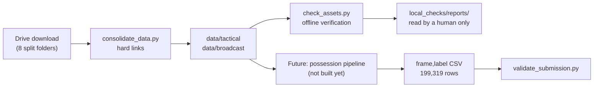
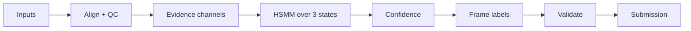

# PROJECT_GUIDE.md

A five-minute understanding of this project.

---

## What this project is

A working folder for **More Than a Hack 2027 — Phase 1: Ball Possession**, a football data
competition run by Metrica Sports, FC Barcelona and Mobile World Capital Barcelona.

**The competition task:** given one full LaLiga match (FC Barcelona vs Athletic Club, 2024-25
matchday 2) with two video feeds, automatic tracking, automatic tactical tagging and camera
homography, produce **one label for every video frame** saying who has the ball.

**The deliverable to the organisers** is a CSV of exactly 199,319 rows, one per frame of the
*tactical* video, each labelled:

| label | meaning |
|---|---|
| `H` | home (Barcelona) in possession, ball alive |
| `A` | away (Athletic Club) in possession, ball alive |
| `D` | dead ball — not in play |
| `X` | no answer / abstain (not a football state) |

Ranked on **spellF1** (whole possessions recovered, matched by temporal IoU), with **macroF1**
(per-frame) as the first tie-break. Published baseline to beat: spellF1 **0.2433**.

**Current stage: analysis and strategy only.** No model has been built, trained or submitted.

---

## Why this folder exists

It holds three different things that must not be confused:

1. **The downloaded match assets** — gated, licensed for this competition only, not
   redistributable.
2. **Local-only tooling** to verify those assets without exposing them.
3. **An internal strategy deck** explaining how the eventual solution should be built.

---

## Rules clarification received 3 November 2026

The organisers restated the rules, and said this restatement takes precedence over the
documentation, earlier emails and individual answers.

**Not allowed:** checking output against the video; hand labels or any manually created data on
the provided game; uploading the provided data to AI services; training, fitting or calibrating on
the ground-truth possession data or the provided video.

**Allowed:** automatic checks using only the provided data; *inspecting* the provided data and the
video to understand what counts as possession; using the video, tracking, smart tagging or any
generated data as model input, provided the model was not trained on the ground truth or the
provided video; shipping intermediate files; any dataset whose licence permits it.

**Training and tuning must use external data only.**

What this changes here:
- Our position is already compliant. Stages 2 and 3 are trained and tuned exclusively by
  leave-one-match-out over the five open-access IDSSE matches, and no model code has opened the
  two sealed matches.
- **Newly unlocked:** inspecting the provided data is explicitly permitted, which covers the
  pending local check of whether the competition file contains referee/officials tracking.
- **Still barred:** sending any of the provided data to a cloud model. Any such check runs locally
  and reports only whether a thing exists, never its contents.
- SoccerNet-GAR's NDA is unaffected — "check the licence of any dataset before using it".

---

## The single most important constraint

The competition FAQ restates the enrolment terms:

> participants shall not upload, disclose or otherwise make available to any third-party hosted
> or cloud-based LLM any videos, datasets, confidential information or other restricted materials
> provided in connection with the Competition, or any extracts thereof

**Consequence:** a cloud-hosted assistant may not read the match videos or data payloads — and
that includes extracted frames, printed rows, screenshots, derived statistics and logs. Storing a
file locally does not change this.

Everything in `local_checks/` exists because of that rule: those scripts run on this machine,
make **no network calls**, and write their reports to a local folder for a human to read.

---

## Folder layout

```
D:\Football Hackathon\
├─ BAR-ATH_tactical.mp4                  5.2 GB   RESTRICTED - the submission timeline
├─ BAR-ATH_broadcast.mp4                14.0 GB   RESTRICTED - optional, own timeline
├─ More Than A Hack ... -1-003 … -010/            RESTRICTED - the Drive download, split
│                                                 across folders, 1-2 files each
├─ data/                                 built by consolidate_data.py (hard links)
│   ├─ tactical/    5 files
│   └─ broadcast/   4 files
├─ local_checks/
│   ├─ consolidate_data.py               rebuild the documented data/ layout
│   ├─ check_assets.py                   verify the assets locally, offline
│   └─ reports/                          output of check_assets.py (local only)
├─ external_data/                        STAGE 1: the external training corpus
│   ├─ DataReadinessReport.md            what is usable, and what is not
│   ├─ scripts/                          sources.json, downloader, 3 parsers, reports
│   ├─ raw/{metrica,idsse,skillcorner,statsbomb}/   originals, never modified
│   ├─ raw/soccernet_gar_probe/          NDA-RESTRICTED index file; evidence only, never
│   │                                    trained on, never published — see its README
│   ├─ processed/<source>/<match>/        frames.parquet + players.parquet
│   ├─ reports/                          manifest, suitability, provenance, splits
│   └─ tools/ffmpeg-9.0.2-essentials_build/bin/   local ffmpeg + ffprobe, no admin
├─ stage2/                               STAGE 2: the dead-ball detector
│   ├─ features.py                       169 features from PLAYER POSITIONS ONLY, no ball.
│   │                                    --degrade pan simulates a broadcast camera feed
│   ├─ DECODER_FIX.md                    the decoder investigated: two bugs found, and the
│   │                                    measurement that says no headroom is left there
│   ├─ LAWS_AUDIT.md                     Laws of the Game -> labels -> available evidence
│   ├─ HARDENING_RESULTS.md              before/after on all requested metrics
│   ├─ compare.py                        spellF1 / macroF1 / dead P+R from saved predictions
│   ├─ features_h/, features_pan/        clean and degraded feature sets
│   ├─ features/<match>.parquet          one file per match, frame-aligned to processed/idsse
│   ├─ train.py                          leave-one-match-out + 3 decoders, scored by the
│   │                                    organisers' own evaluation/possession_metrics.py
│   ├─ README.md                         method and the reasoning behind it
│   ├─ RESULTS.md                        what it scored, and what the numbers do not mean
│   ├─ results_lomo.csv                  per-fold, per-decoder results
│   ├─ failures.py                       catalogues every error by type and cost
│   ├─ failures_{hsmm,smooth}.csv        372 cases: match, half, clock, frame range
│   ├─ render_case.py                    draws a case as top-down pitch views
│   ├─ predictions/<match>.parquet       per-frame probability and decoded output
│   └─ cases/*.png                       rendered failure cases for inspection
├─ stage3/                               STAGE 3: which team is in control
│   ├─ features_team.py                  direction inferred from data; ball features carry an
│   │                                    explicit observed flag and go NaN when absent
│   ├─ train_team.py                     ball-masking augmentation + end-to-end scoring,
│   │                                    decomposed into stage2-only / stage3-only / combined
│   ├─ pitch_control.py                  time-to-intercept control surface, 15x10 grid
│   ├─ path_model.py                      possession as a path over 22 player states + flight
│   ├─ player_labels.py                  per-frame PLAYER-level possession from the event feed
│   ├─ restart_logic.py                  THE SHIPPED OUTPUT. Hardening pass over the decode:
│   │                                    reads the restart off the coordinates, aligns the
│   │                                    resume edge to the ball being kicked, gives an
│   │                                    unambiguous corner to the attacking side, and exports
│   │                                    its reasoning per frame
│   ├─ RESTART_HARDENING.md              before/after on every requested metric, and the three
│   │                                    steps the measurement rejected
│   ├─ predictions_refined/<match>.pq    hardened labels + last control, restart team, restart
│   │                                    kind, first ball frame, k-NN margins, switch reasons
│   ├─ train_emissions.py                learns the per-player emission; run_trained_path.py
│   │                                    decodes the path with it
│   ├─ FULL_PICTURE.md                   the honest whole-model status, and the 0.947 correction
│   ├─ _dryrun_*.csv / .parquet          measurements behind the dry-run report
│   └─ results*.csv                      per fold, per ball-masking rate, per approach
├─ review/                               LOCAL Model Failure Review tool
│   ├─ server.py                         loopback-only server + feedback persistence
│   ├─ app.html                          the page: guided demo, replay, synced per-frame table,
│   │                                    model rationale, timing bars, ball strip, patterns
│   ├─ export_cases.py                   builds the case bundles: failures (confirmed vs
│   │                                    contested), cases the model gets RIGHT, and the model's
│   │                                    own rationale in nats
│   ├─ make_demo.py                      renders demo/model_demo.mp4 - the guided walkthrough
│   ├─ patterns.py                       recurring failure patterns + reusable flags
│   ├─ scoreboard.py                     the one table behind the How it is doing tab: accuracy
│   │                                    now vs before, and every remaining case by kind
│   ├─ evaluate.py                       snapshot / compare spellF1, macroF1, failure counts
│   ├─ README.md                         how to run it, and what is pending on permission
│   ├─ data/                             index.json, patterns.json, cases/*.json  (34 MB)
│   ├─ demo/model_demo.mp4               2 min 48 s guided demo + stills/ of the key moments
│   ├─ feedback/feedback.json            reviewer notes - never auto-promoted to labels
│   └─ snapshots/                        baseline.json and any later comparison points
├─ deck/                                 reproducible build of the strategy deck
│   ├─ theme.js, layouts.js              palette, label colours, slide layouts
│   ├─ viz.js                            pitches, player dots, probability traces, possession
│   │                                    bands, bars, a balance scale and a scorer avatar
│   ├─ dryrun_data.json                  real coordinates and traces behind every diagram in
│   │                                    the dry-run report, written from the IDSSE files
│   ├─ slides_*.js                       one module per group of slides
│   ├─ slides_explainer.js               plain-English section, with cricket parallels
│   ├─ build_deck.js                     entry point — strategy deck
│   ├─ build_blockers.js                 entry point — blockers document
│   ├─ build_primer.js                   entry point — two-page plain-language primer
│   ├─ build_final.js                    entry point — two-page final report
│   ├─ build_dryrun.js                   entry point — five-page dry-run report
│   ├─ export.ps1                        PPTX -> PDF + PNG, via installed PowerPoint
│   └─ render*/                          per-page PNGs, for visual checking
├─ Talent_Arena_2027_Model_Strategy.pptx DELIVERABLE  (23 main slides + 5 appendix)
├─ Talent_Arena_2027_Model_Strategy.pdf  DELIVERABLE  (exported from the .pptx)
├─ Talent_Arena_2027_Blockers.pptx/.pdf  DELIVERABLE  (10 pages, one blocker each)
├─ Talent_Arena_2027_Primer.pptx/.pdf    DELIVERABLE  (3 pages, plain language + status)
├─ Talent_Arena_2027_Stage2_Review...    DELIVERABLE  (5 pages, Stage 2 failures + plan)
├─ Talent_Arena_2027_Status.pptx/.pdf    DELIVERABLE  (2 pages, status at a glance)
├─ Talent_Arena_2027_Final_Report...     DELIVERABLE  (2 pages, where it stands and why)
├─ Talent_Arena_2027_Dry_Run.pptx/.pdf   DELIVERABLE  (7 pages, illustrated: real pitch
│                                        diagrams, confidence traces, possession bands and the
│                                        marking arithmetic drawn out, plus the gap table)
└─ PROJECT_GUIDE.md                      this file
```

The **challenge repository** (`metrica-sports/more-than-a-hack-2027`) is *not* checked out here.
It is public and is read directly from GitHub when needed. Reviewed at commit `f8f2629`
(23 Oct 2026).

---

## The nine match assets

| source | files |
|---|---|
| `tactical/` | `.mp4`, `_atd.xml`, `_atd.txt`, `_homography.csv`, `_smart_tagging.xml` |
| `broadcast/` | `.mp4`, `_atd.xml`, `_atd.txt`, `_homography.csv` |

- **ATD** (Automatic Tracking Data) — Metrica's FIFA/EPTS export: positions and speeds of every
  tracked object, including the ball, once per video frame. Automatic and uncorrected.
- **Smart Tagging** — Metrica's automatic tactical annotation, 638 phases, SportsCode XML.
  Tactical feed only.
- **Homography** — one 3×3 matrix per frame mapping normalised pitch coordinates (0–1) to pixels.

All nine were confirmed present and non-zero using **filenames and byte sizes only**.

---

## Data flow



Nothing from `data/` or from the reports is sent anywhere.

---

## The recommended solution architecture (proposed, not built)



**Why this shape.** The published baseline couples two decisions that should be separate: *is the
ball in play* and *which team has it*. Its only dead-ball rule is "the tracker lost the ball",
which is why its D class is weak while its team call is already reasonable. The proposal is to
split those decisions and to model possession as an **interval** rather than as a stack of
independent frames.

**Technology choices:**

| Technology | What it does | Why chosen |
|---|---|---|
| Python + numpy/pandas | All data handling and the scorer | What the official scorer uses; no version pinning problems; runs anywhere |
| Hidden **semi**-Markov model | Infers H/A/D over time with explicit state durations | A plain HMM's dwell time is geometric, so its most likely possession is one frame — exactly the fragmentation that destroys spellF1. Explicit durations fix that without a flat smoothing window |
| Viterbi decoding | Produces the most likely state path | Output is whole intervals by construction, which is what spellF1 scores |
| Collective geometry features | Centroids, spread, convergence on the ball | The 46 track slots are tracklets, not players — no per-player feature is buildable |
| kloppy (optional) | Reads the FIFA/EPTS and SportsCode formats | Only needed for the starter notebooks; the baseline reads the raw files with numpy alone |
| pptxgenjs + PowerPoint COM | Builds and exports the strategy deck | Deck is regenerated from source; exporting via PowerPoint guarantees the PDF matches the PPTX |

---

## Frame and time conventions

The most common source of silent error. Five different clocks:

| Signal | Its own index | To a submission row |
|---|---|---|
| Submission / tactical video | 0 … 199318 | it *is* the row number |
| ATD tracking | `frame_id` 1 … 199319 | `video_frame = frame_id - 1` |
| Smart Tagging | seconds from video frame 0 | `video_frame = round(s × 25)` |
| Homography | `frame` 0 … 199318 | already a row number |
| Broadcast | its own 164,488 frames | no mapping provided |

**Graded frames:** 11,185–90,651 and 110,808–190,197 = 158,857 frames. Everything else is
ungraded, where `X` costs nothing. The second half is graded from 110,808 but does not kick off
until 113,742 — those 2,934 frames are graded and all `D`.

---

## How to run things

Rebuild the documented data layout (hard links; no 19 GB copy):

```bash
python local_checks/consolidate_data.py --source "D:/Football Hackathon" --data-dir "D:/Football Hackathon/data"
```

Verify the assets, offline:

```bash
python local_checks/check_assets.py --data-dir "D:/Football Hackathon/data"
```

Rebuild the strategy deck and export the PDF:

```bash
cd deck && NODE_PATH=./node_modules node build_deck.js
```

Rebuild the blockers document or the two-page primer the same way — swap in `build_blockers.js`
or `build_primer.js`, then run `export.ps1` with that document's `-Pptx`, `-Pdf` and `-PngDir`.

```bash
powershell -ExecutionPolicy Bypass -File "D:\Football Hackathon\deck\export.ps1"
```

Run the Model Failure Review tool (local, loopback only):

```bash
python review/server.py
```

Rebuild the hardened output, its cases, and the guided demo after a model change:

```bash
python stage3/restart_logic.py --compare --apply
python review/export_cases.py && python review/patterns.py
python review/scoreboard.py && python review/make_demo.py
```

Point the challenge repository at the data:

```bash
export MTAH_DATA_DIR="D:/Football Hackathon/data"
```

---

## Configuration and secrets

There are **no credentials, API keys or tokens** in this project, and none are needed. The only
configuration is the environment variable `MTAH_DATA_DIR`, which tells the challenge repository
where the match bundle lives.

---

## Error handling

The local scripts are written to **report rather than repair**. Every check prints `PASS` or
`MISMATCH` against the numbers the organisers publish. Where a count disagrees — most importantly
a decoded video frame count that is not 199,319 — the correct response is to find out why and
raise it with the organisers, **not** to pad or trim the data to fit. The competition FAQ is
explicit about this.

---

## Dependencies

- **Python** 3.14.2 here; numpy 2.4.1, pandas 3.0.0 (scorer needs only these two)
- **Node** 24.18.0 with `pptxgenjs` (deck build only)
- **PowerPoint** 16.0 (PDF and PNG export)
- **ffmpeg / ffprobe** — *not currently installed*. Not needed for the strategy work. Install it
  before the day-one correctness gate: the video section of `check_assets.py` uses it to confirm
  the decode really is 199,319 frames, which is what the submission row count depends on

---

## Current status

| Item | State |
|---|---|
| Challenge repository reviewed | Complete — all 34 files at `f8f2629` |
| Official scorer reproduced | Yes — published public-window board matches to 4 dp |
| Public CSVs parsed and validated | Yes — all 5, all 199,319 rows, all pass |
| Match assets verified | **Filenames and sizes only** — contents not opened (rules) |
| Local verification scripts | Written, compile-checked; not yet run against the data |
| Strategy deck | Delivered (`.pptx` + `.pdf`, 23 main slides + 5 appendix) |
| Blockers document | Delivered (`.pptx` + `.pdf`, 10 pages) |
| Plain-language primer | Delivered (`.pptx` + `.pdf`, 2 pages) |
| **Stage 1 external data** | **Complete** — 30 matches, 2.61 M frames, 4.6 GB, all parsed and reported |
| Additional-sources sweep | Complete — 10 sources assessed, 4 usable; two web sweeps found no further open source |
| Possession convention | **Resolved 30 Oct 2026** — the DFL defines possession by the player *in control*, matching the competition. IDSSE is convention-correct; Metrica is touch-based |
| Dead-ball ground truth | **Validated 30 Oct 2026** — our labels match the DFL's official net playing time to 0.00 pp on all 7 matches. See `external_data/reports/DeadBallProfile.md` |
| SoccerNet-GAR | **Admitted for H/A pre-training only (30 Oct 2026)** — 87,939 touch events, 64 matches; `team` field tested and trusted. Useless for dead-ball interiors (66.1% untracked). Eligibility risk accepted by the user |
| **Stage 2 dead-ball detector** | **Built and measured.** Players only, no ball features. **spellF1 0.862** (corrected 2 Nov — the earlier 0.947 forgave missed stoppages; see `stage3/FULL_PICTURE.md` §0). HSMM decoding still beats plain thresholding by a wide margin |
| **Stage 3 team attribution** | **Built 2 Nov 2026.** Direction inferred per team per period from the data; ball features paired with an explicit observed flag; trained with ball-masking across 0–65%. Team accuracy **85%** at the competition's 41% ball rate, but **spellF1 only 0.496** — possession spells are too short for 15% frame error |
| **END TO END** | **spellF1 0.430, macroF1 0.852** at 41% ball missing. First honest whole-task number. **Stage 3 is the bottleneck** (0.496 vs Stage 2's 0.862) |
| Ball robustness | Masking works: only **0.06 spellF1** lost between a clean view and 41% missing. The ball is not the main problem |
| Pitch control | **Built and tested 2 Nov — it did not help.** +0.002 spellF1. Three feature families (geometry, ball proximity, control surfaces) all saturate team accuracy at 85–88%, which says the limit is the model class, not a missing feature |
| Possession duration prior | **Real bug found and fixed** (it was fitted across stoppages, gluing possessions together) — **but no effect**: 0.430 → 0.428. The spell under-production is the classifier's probability being too smooth, not the decoder |
| **Occlusion training** | **ADOPTED as the Stage 2 default.** Trained on a heavy broadcast-like feed, scores **0.929 on a severity it never saw** against 0.935 on the trained one. Genuine robustness, not memorisation |
| PathCRF-style rebuild | **Built and tested 3 Nov — it did not beat the per-frame model either.** spellF1 0.428 against 0.432. It *does* fix much of the spell under-production (316 of 410 against 261) and the path structure alone scores 0.821 team accuracy with no learned model. Licence note corrected: PathCRF's README states **no** licence, not MPL-2.0 |
| **Stage 3 ceiling** | **Four structurally different attacks all land at 0.428–0.432**, team accuracy 0.843–0.856. That flat a response says the limit is the information available, not the model class. Stop adding features |
| Player-level labels | **Built and trained 3 Nov — it made things worse.** spellF1 0.397 against 0.432. Derived labels agree with the DFL's own per-frame field on 89.2–91.4% of live frames |
| **THE CEILING, EXPLAINED** | **The DFL's two official products disagree with each other on ~10% of live frames.** Our models reach 85%; derivable supervision tops out at 90%. Five architectures all land at team accuracy 0.843–0.856. **This is a data limit, not a modelling limit — stop building Stage 3** |
| Referee tracking | Present in **J03WMX and J03WN1 only** — the two sealed test matches. Unusable without burning the holdout. **Worth one local check of whether the competition file includes officials** |
| Slot-masking bug | Untracked substitute slots were winning the possession path (2nd halves collapsed to 0% home). Fixed. **Direct warning for the competition's 46 anonymous slots, most idle at any moment** |
| Stage 2 failure review | **Done (31 Oct 2026)** — 372 errors catalogued. Invented stoppages (50, 10/match) outnumber missed ones (12, 2.4/match) **4 to 1**, which reversed the tuning priority. Root cause: the top 3 features are all player speed, so a lull reads as dead and a quick restart reads as alive |
| Stage 2 hardening | **Done (1-2 Nov 2026)** — 4 changes, 108 → 169 features. On clean data spellF1 is unchanged (0.948 → 0.947); danger-zone recall rose 70.6% → 79.3%. See `stage2/HARDENING_RESULTS.md` |
| **Occlusion finding** | **The big one.** On a realistic broadcast feed (14.3 of 22 players, 14% of frames empty) a clean-trained model falls **0.948 → 0.792 spellF1** while frame F1 only goes 0.971 → 0.928. Training on the degraded feed recovers it to **0.935** — occlusion augmentation is the fix |
| Decoder choice | **`smooth` reinstated as fallback.** It was dropped on clean-data evidence; on a degraded feed it beats `hsmm` (0.861 vs 0.792, 0.839 vs 0.716). Keep both until the augmented model ships |
| Laws audit | `stage2/LAWS_AUDIT.md` — Law 9/8/11 mapped to available tracking evidence, with the evidence ceiling quantified: 24% of missed stoppages have no signal at all, because there is no referee in the data |
| Lag finding | Stoppages start a median **+1.10 s late** — but a worked example through the official scorer shows that costs spellF1 nothing and only hurts macroF1, so the fix is demoted |
| Test matches | **Still sealed.** J03WMX and J03WN1 have never been loaded by any model code |
| **Model Failure Review tool** | **Built 3 Nov 2026, extended 4-5 Nov** (`review/`, local, loopback-only). 2,977 cases across the five external development matches — **2,561 failures** (1,656 confirmed / 905 contested) and **416 the model gets right** (`STOPPAGE_CAUGHT`, `TURNOVER_CAUGHT`, `SPELL_HELD`), 737 with replay bundles. Each case opens as a **plain-language read-out in four fixed parts** &mdash; the two answers compressed into their runs with the seconds they disagree on, the one reading of these frames that decided it (ball unseen / touch in flight / restart layer / ball at rest / nearest player) together with the model's own probability and whether the answer matches it, the chips of numbers that prose is drawn from, and the mistake restated **in cricket scorer's terms**; then the two answers drawn side by side, up to three signs that were visible with *used it / did not act on it* marks, a confidence bar (the decoder's nats read as a probability against the confidence that stop needed), and the one lesson to teach &mdash; with every number still available behind *Show all the numbers*: the per-frame table, the **model's own rationale** (stage 2: emission evidence in nats against the duration prior's ~9-nat charge, read straight off the decoder's objective; stage 3: the cues it was given, marked for which side each supports), **timing bars** comparing the actual span with the model's, and a **ball strip** separating the ball in the file from the ball the model was allowed to use. Reviewer bookmarks, verdicts and comments persist to `review/feedback/feedback.json` with `used_for_training: false`. Each case also carries **`ball_seen`** &mdash; the share of its window where the ball was visible to the model &mdash; with its own filter, because a case the ball cannot be seen through cannot be taught: the reviewer is looking at the same empty pitch the model was. Of the 2,561 failures, **930 (36%) have the ball in sight for 80%+ of the window** (534 of those corroborated, 287 openable), while 1,178 (46%) have it hidden for more than half and 668 never show it at all. A **How it is doing** tab carries one table, built by `review/scoreboard.py`: the accuracy measures now against the model before the hardening work, then every remaining case by kind, each row clicking through to exactly those cases |
| **Restart hardening** | **Built 5 Nov 2026** (`stage3/restart_logic.py`). Restart kind read from the resting ball and the players around it; the resume edge moved onto the ball actually being kicked; an unambiguous corner given to the side attacking that goal. **34 individual failures fixed, 3 new, net −31, all in the `confirmed` column.** Restart edge error 1.446 s → **1.311 s**; restart team 430 → **436** of 460; false switches 431 → **419**; spellF1 0.438 → 0.446 and macroF1 0.855 → 0.858, both inside their noise bands. A later restart edge is gated on the ball being visible **or** stage 2 still calling it dead: ball evidence alone broke nine well-timed stoppages, because a hidden ball looks exactly like a ball that is not moving. The three cases the change did create are tagged in the index and have their own filter in the review page. **The touch rule (5 Nov 2026):** the ball's own trajectory is cut at every touch (pace dropping to 60% or less, or the course turning more than 60 degrees, with a player inside 1.5 m) and each piece of the track is given to whoever played it, while the ball is above 5 m/s. This reaches the one case a per-frame classifier cannot: while a pass travels, the nearest player is often the opponent it is going past. **325 cases fixed, 176 new**; spellF1 0.438 → **0.482**, the first change here to clear its own 0.04 noise band; macroF1 0.855 → 0.865; missed switches 1206 → 1048, false switches 431 → 497. All five matches improve. **Two Laws the model had never been told (9 Nov 2026):** from reviewer notes. **A visible ball outside the pitch and barely moving for a second is dead** — 99% of all out-of-pitch frames are dead in the reference, and 95% of the ones the model still called live; no distance-to-player test, because at a throw-in the taker stands right beside it. **A stretch of play under 2 s between two stoppages is not play**, nor is one under 4 s where the ball never moved 2 m: under 1 s such stretches are 100% dead, 8 s and over only 3%. Together **spellF1 0.511 → 0.519**, macroF1 0.881 → **0.884**, failure cases 2,597 → **2,561**. **False switches — measured, nothing shipped (8 Nov 2026):** **73%** of the 439 come from the per-frame team model itself, not from the hardening rules, and the possessions they invent run to a median of 5.1 s, so no length floor reaches them. Refusing a switch to a team with nobody within 3 m of the ball saves 67 false switches for 23 real ones and cuts 80 failure cases — and costs **six points of team accuracy** (87.7% → 83.4%) and 0.028 of spellF1, because a blocked switch hands those frames to the wrong team until the next one. Gating it on the ball's own vote, and tightening what counts as a touch, are worse on every graded measure too. Kept as `--parts reach`, off by default. The lesson: the case list counts events, the score counts frames and possessions, and when they disagree the score decides. **Missed changes of hands (8 Nov 2026):** the biggest pile, and not what it looked like — only 12% of the 1,032 are possessions shorter than the model's 0.8 s floor, the median is **3.1 s** and 42% last over four seconds. The cause is structural: outside a restart window the refined sequence is the per-frame team model's own output, and the nearest-player vote never gets to take the ball off it, even though it pointed the right way in **45%** of the misses. Where that vote is firm and disagrees, it is right 64% of the time if somebody is within 2 m of the ball and only 41% at any distance — so it may now override within **1.5 m**, held 0.6 s. **74 cases fixed, 45 new.** **Wrong team, profiled (8 Nov 2026):** over the frames both the model and the reference call live, 12.6% get the wrong side, and the single biggest factor is whether the flight rule is speaking: **3.4%** wrong while following a struck ball against **15.5%** elsewhere. So the flight gate was re-swept now that the ball track is bridged — `FLIGHT_HOLD_V` 5.0 → **3.0 m/s**, which is where it meets `FLIGHT_V_END`, so the rule covers the whole of a moving run (2,662 → 2,635 cases) — and the still-ball radius became its own number at **2 m** (2,635 → 2,621). Measured and found inert: `MARGIN_MIN`, `PERSIST_S` and `PERSIST_FRAC` change nothing, because they only bite inside a restart hold. Measured and rejected: every simple policy for blind stretches (carry, take the next sighting, half-and-half) is worse than what the model already does. **Bridging the blind spot (8 Nov 2026):** the ball is hidden from the model 41% of the time, and those stretches sit in the middle of passes, where possession is decided. Where the ball is seen on both sides of a gap, a straight line between the sightings lands within **0.17 m** of the real ball for gaps up to 1.6 s and **0.91 m** up to 3.2 s, so gaps up to **3.2 s** are now joined up. The bridged ball is given only to the rules that follow the ball — flight, touch and the moving-ball veto — and never to the per-frame nearest-player vote. **137 cases fixed, 64 new**, spellF1 0.487 → **0.501**, and false switches 474 → **444**, the first change in this layer to push them down. Sweep: 1.6 s +61 net, 3.2 s +73, 6.4 s +52. **Eleven a side (8 Nov 2026):** a reviewer's rule — a player standing off the pitch within 10 m of the resting ball is the one taking the restart. It names the taker correctly on **95%** of the 155 restarts where it fires, against the model's **85%** on those same restarts, and wins 16 of the 17 disagreements, so it now sets `restart_team`. It is not allowed to impose that team on the following play: three versions of that were measured at 16/109, 4/32 and 11/120 cases fixed against created. **The ball-in-play veto (6 Nov 2026):** the mirror of the rule below, and from four reviewer notes about stoppages the model invented while play was going on. A visible ball moving at **1.5 m/s or more inside the pitch** for half a second is live in **198 of 198** measured windows, so it vetoes the stoppage; the players' pace, which re-times the whistle well, is worthless here (11-15%). A stoppage that contains play survives as its longest stretch, and the frames handed back take the team from the side they sit on — before the stoppage whoever had the ball, after it whoever restarts; the two simpler versions measured −47 and −17 cases against **+15**. A ball outside the pitch now gives possession to nobody. macroF1 0.871 → **0.875**, right team on live frames 83.5% → **84.5%**, `BOUNDARY` cases 212 → **172**, failure cases 2,752 → **2,736**. Measured and rejected: a player in contact with a visible ball as evidence of play (25-49%). **The ball-at-rest rule (6 Nov 2026):** a visible ball moving under **0.5 m/s** with no player inside 3 m for a second or more is a stoppage — over the five development matches, 86 such windows cover 4,426 frames the model was calling live and the reference calls **100%** of them dead. A football does not stop on its own, so unlike the player-pace signal this one is allowed to find a stoppage of its own, and is folded into the dead mask before the whistle and restart logic run. **38 cases fixed, 10 new**; stoppages found 489 → **492 of 503**, macroF1 0.866 → **0.871**, failure cases 2,780 → **2,752**. Measured and rejected beside it: rolling the window back to where the ball started slowing (0 usable frames) and imposing the throw-in taker named by the last touch (11 fixed against 120 created). **The whistle rule (5 Nov 2026):** all 22 players average **1.10 m/s** while the ball is dead against **2.42 m/s** while it is live, so where play stops is visible in the players as well as the ball. The signal is strong but slow — the walk sets in a median 4.6 s after the whistle — so it is used only to re-time a stoppage stage 2 already found: the whistle is placed halfway between stage 2's edge and the steepest fall in team pace. Whistle timing over 489 stoppages improves from 0.80 s to **0.70 s** median error, and from 56% to **61%** inside a second; **85 cases fixed, 48 new**, false switches 497 → 476, failure cases 2817 → **2780**. The score moves are inside their noise bands (spellF1 0.482 → 0.485, macroF1 0.865 → 0.866). Measured and rejected: declaring a new stoppage from a pace drop (14–36% precision), extending a stoppage while the pace stays low (18–46%), and timing the restart off a pace rise (0.36 s → 0.96 s, worse even where the ball is masked). Measured and rejected: imposing the nearest player at the launch on every moving ball (382 fixed, 538 broken), and the brief's deflection gate (every step trades two fixes for one regression avoided). Measured and **rejected**: holding the restart team for every restart (−0.036 spellF1) and carrying possession through ball gaps (−0.019) — the model already reads restarts better than a rule, 93.5% against 82.1%. See `stage3/RESTART_HARDENING.md` |
| **Guided demo video** | **Built 4 Nov 2026** (`review/make_demo.py` → `review/demo/model_demo.mp4`, 2 min 48 s, 1280×720). Two stoppages from the same half of J03WOH: 35:56 caught to within 0.08 s / 0.16 s at 100% overlap, 06:46 missed outright. Every figure in it is computed from the exported bundles. Embedded in the page under the **Watch this first** tab |
| Confirmed vs contested split | **The important design choice.** A case counts as a model error only where the DFL's two products (per-frame `BallPossession` and the event-derived holder) agree. Where they disagree the reference is unsettled. **581 of 1,206 `MISSED_CHANGE` and 306 of 961 `WRONG_TEAM` cases are contested** — nearly half and a third. Those should not be worked on as model defects |
| Failure patterns, quantified | **`within_1s_of_turnover` carries 55% of team errors on 10% of frames, lift 11.0x, consistent in all five matches.** Then `reference_contested` (5.7x) and `contested_margin_1m` (2.8x). `ball_unseen_any` is only 1.36x — the ball is again not the main problem. `loose_ball_5m` has lift **0.35x**: a loose ball is easier, consistently. Flags are association, not cause, and thresholds were chosen in advance |
| No video for replay | IDSSE ships tracking only, so every replay is a clearly labelled animation. The 3 Nov clarification permits *inspecting* the provided video, so an inspection-only pane is possible. **Pending a decision** |
| **Decoder investigated and fixed** | **3 Nov 2026** (`stage2/DECODER_FIX.md`). Two real bugs. (1) `train.py`'s own metric could not see a missed stoppage — the same `np.where(pred_dead, "D", truth)` fall-through found earlier was never fixed *in the training loop*, so every decoder decision was made blind to half the error. Honest baseline **0.872**, not 0.947. (2) The duration prior was a 1000-bin histogram with **76% of bins empty inside its own range**, charging 13 nats for a 1 s stoppage and 5 for a 2 s one; replaced with a Gaussian kernel in log time, Silverman bandwidth per fold |
| Decoder headroom | **None left.** The missed stoppages are a classifier failure, not a decoder one: mean probability **0.29** over the span against 0.95 on caught ones, with only a ~1 s spike. A dead-state bias sweep over LOMO tops out at **0.873 against 0.871 shipped** — inside the 0.04 noise band — and forcing recall triples invented stoppages. No bias adopted; a tuned constant for a sub-noise gain is overfitting |
| Correction to the dry-run report | The claim that "79% had the signal and the decoder refused it" measured the **peak** probability, which is a 1.0 s blip inside an 8 s stoppage. Only 46% contain a sub-window worth more than 10 nats. Page 5 of the report is being reissued |
| **Dry-run report** | **Delivered 3 Nov 2026** (`Talent_Arena_2027_Dry_Run.pdf`, 5 pages). Traces two real stoppages from raw rows through features, probability, decoding and the organisers' own scoring arithmetic, plus a 22-player emission dump and the measured gap table. Measurements in `stage3/_dryrun_*.csv` |
| Which stoppages we miss | **Measured 3 Nov 2026** over 503 real stoppages. Caught: 98.8% over 20 s, 95.7% when the team changes, 92.8% same-team, **82.0% same-team under 10 s, 73.7% under 5 s**. Of the 28 missed, **79% had peak probability > 0.5 — the decoder refused them** (fixable in code) and only 14% had no signal at all. This supersedes the 24% figure in `LAWS_AUDIT.md`, which was measured on the pre-hardening model |
| Shape of the Stage 3 errors | **Measured 3 Nov 2026**: 514 wrong stretches in one match, **median 0.60 s**. 53% of wrong frames sit within 1 s of a real possession change against 24% of frames overall; 22% are coin tosses, 15% confidently wrong |
| Training-data ball visibility | **IDSSE shows the ball in 100% of frames in all seven matches**, against the competition's ~41% hidden. Every robustness claim here rests on simulated masking, never on real gapped data |

**The two cheapest actions left**, in order: (1) one local check of whether the competition's own
file includes referee/officials tracking — the referee is the only direct evidence a stoppage
exists, and it reaches exactly the short same-team restarts we fail; (2) send the drafted Sportec
request (`Sportec_IDSSE_data_request_DRAFT.md`) for matches from more clubs, since five of our
seven share one home club.

**The remaining Stage 2 score is in the classifier, not the decoder** — measured 3 Nov 2026, and
this reverses what the first dry-run report said. Over a missed stoppage the classifier's mean
probability is 0.29; the confident moment is a one-second blip. No decoder setting recovers them
without losing more to invented stoppages. See `stage2/DECODER_FIX.md`.

**Deadline:** 17 November 2026. Results announced before 26 November 2026.
